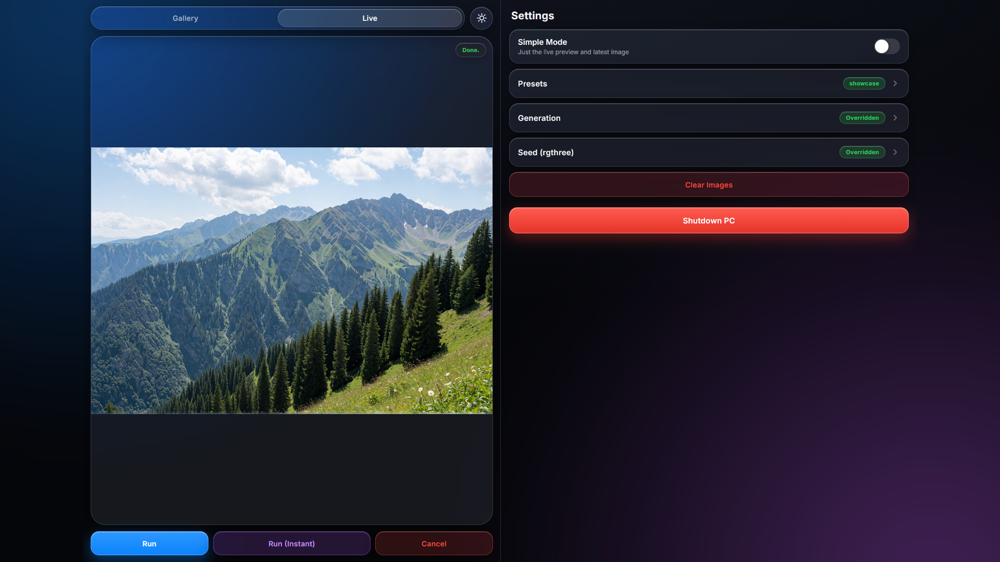
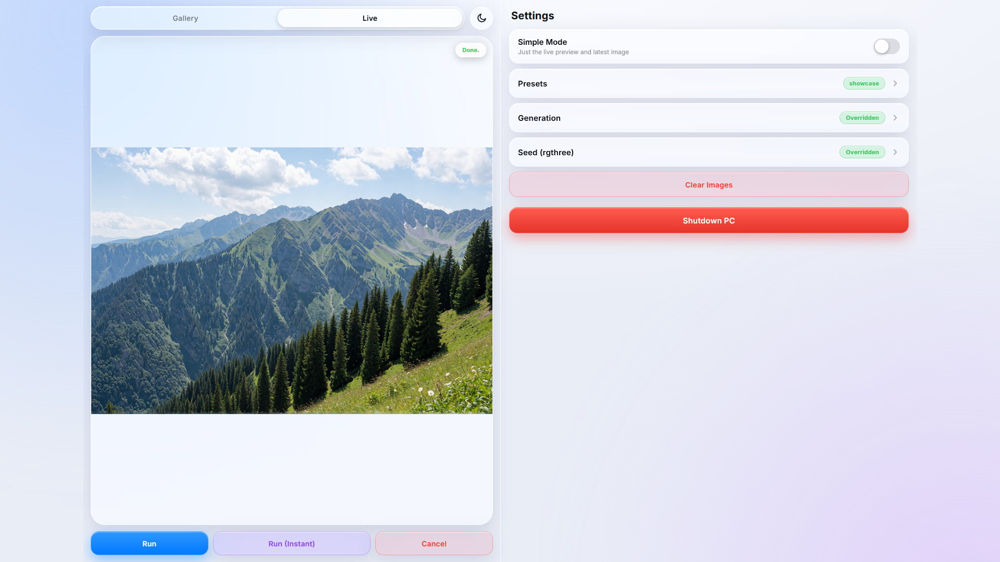
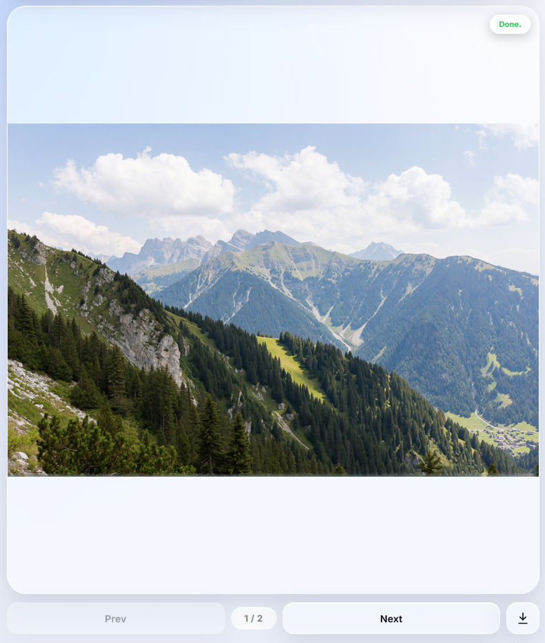
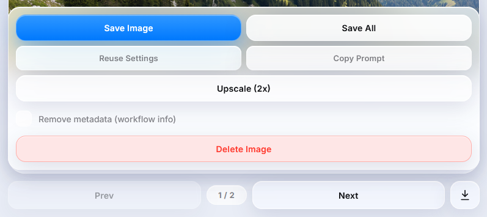
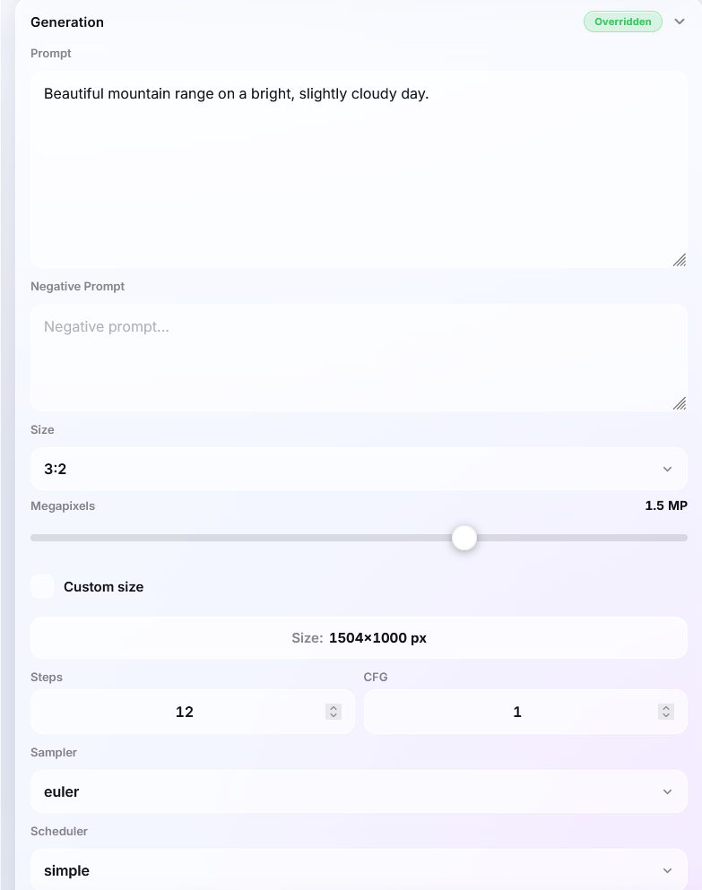
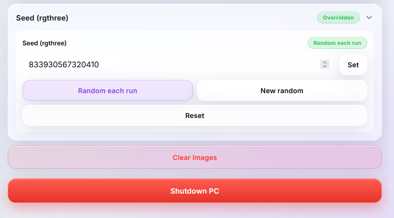

# ComfyUI LAN Control Panel

Turn any phone, tablet, or computer on your Wi-Fi into a **remote control for ComfyUI**.

Watch generations happen live, start and stop runs, and edit your generation settings — prompt, negative, size, steps, CFG, sampler, scheduler and seed — straight from the browser. No app, no account, no internet required. It started as a simple image viewer and grew into a lightweight control panel for ComfyUI over your local network.

| Dark | Light |
|:---:|:---:|
|  |  |

---

## Highlights

**Watch**
- **Live preview** of the KSampler as it samples, with a **step counter** (e.g. `12 / 20`).
- **Seamless live-to-final**: the preview automatically swaps to the full-resolution finished image.
- **Session gallery** with `Prev` / `Next` and a counter, so you can flip back through everything generated this session.
- **Pinch-to-zoom & pan** on any image for inspecting details up close.
- A status pill that turns green with **Done.** when a run finishes.

**Control**
- **Run** a workflow, or **Run (Instant)** to loop generation continuously. Tap **Stop Loop** to finish after the current image.
- **Cancel** instantly to abort sampling and clear the queue.
- Works from any device on the same network, at the same time.

**Customize (from the web UI)**
- One **Generation** panel for everything that goes into a run: **prompt** & **negative**, **size** (aspect ratio + megapixels, or exact width/height), **steps**, **CFG**, **sampler** and **scheduler**.
- **Seed** — set a fixed seed, roll a new random one, or randomize every run (works with the `Seed (rgthree)` node).
- **Presets** — save the whole Generation panel plus the seed as a named preset, then load, overwrite, delete, or unload them from a dropdown.
- **Reset to defaults** restores everything to the workflow defaults in one tap.

**Gallery actions**
- **Save image** / **Save all** (a `.zip` of the session).
- **Reuse settings** — reads the settings baked into a generated PNG and loads them back into the panel.
- **Copy prompt**, and an optional **Remove metadata** toggle so saved images don't carry your workflow.
- **Upscale (2x)** — send the selected image through a **SeedVR2** workflow and insert the result right after it (requires the SeedVR2 extension — see [Upscaling](#upscaling-seedvr2)).

**Nice to have**
- **Simple Mode** — one switch hides everything except the live preview and the newest image, turning the panel into a clean, always-on *second display* for ComfyUI (this is basically the original purpose of the project, now provided as a toggle).
- Clean iOS-style interface with **light & dark mode**.
- Smooth and snappy, with **image caching and preloading** so navigation is instant.
- Remote **Clear** and **Shutdown PC** controls.
- The gallery **persists across restarts**, so your images are still there when you come back.

---

## Setup

### 1. Install

In your ComfyUI `custom_nodes` folder:

```
cd ComfyUI/custom_nodes/
git clone https://github.com/inxanedev/comfyui-lan-image-server.git
```

Then **restart ComfyUI**.

### 2. Start ComfyUI on your network

For other devices to connect, ComfyUI must listen on all interfaces (`0.0.0.0`). Launch it with:

```
python main.py --listen 0.0.0.0 --port 8000 --preview-method latent2rgb
```

> `--preview-method latent2rgb` (or `taesd`) is what enables the **Live Preview** tab.

### 3. Open the control panel

On any device connected to the same Wi-Fi, open:

```
http://<your-computer-ip>:8000/inx/view
```

The IP is also printed in the ComfyUI console the first time an image is served, for example:

```
[Serve Image on LAN] Image added to history (1)
 -> Access: http://192.168.1.20:8000/inx/view
```

> **First run:** queue a workflow once from ComfyUI so the panel learns the active workflow. After that you can drive it entirely from your phone.

---

## The Nodes (category: `inx`)

Double-click the canvas and search under the **`inx`** category.

### `Serve Image on LAN`
The core node — it streams images to the web panel.

- **Input:** `images` (IMAGE)
- **Output:** `images` (IMAGE) — passes the image straight through

**How to use it**
1. Connect your image (e.g. from **VAE Decode**) to its `images` input.
2. It shows a **preview right inside the node** (like *Preview Image*), so it can replace your existing preview node.
3. Because it passes the image through, you can **daisy-chain** it: `VAE Decode -> Serve Image on LAN -> Save Image`.

### `Fetch Generation Settings (LAN)`
One node that outputs all of the generation settings, which you then control from the web panel. Its input widgets are the **workflow defaults**; anything you change in the panel overrides them for the next run.

- **Outputs:** `text` (STRING), `negative` (STRING), `width` (INT), `height` (INT), `steps` (INT), `cfg` (FLOAT), `sampler_name`, `scheduler`
- **Inputs (defaults):** `default_text`, `default_negative`, `default_steps`, `default_cfg`, `default_sampler_name`, `default_scheduler`

**How to use it**
1. Set your defaults on the node (prompt, steps, etc.).
2. Wire the outputs:
   - `text` / `negative` → **CLIPTextEncode** (`text` input)
   - `width` / `height` → **Empty Latent Image**
   - `steps` / `cfg` / `sampler_name` / `scheduler` → **KSampler**
     *(for `sampler_name` and `scheduler`, right-click the KSampler widget → **Convert widget to input** first)*
3. Open the **Settings** tab to override any of them remotely. Resolution defaults to 1:1 at 1.5 MP and is configured in the panel.

> **Tip:** if you already have the values on your nodes, you can leave the defaults blank and just wire the outputs — the panel's values take over.

---

## Using the Web UI

The panel has three tabs: **Gallery**, **Live**, and **Settings**.

### Gallery
Browse every image generated this session. Use **Prev** / **Next** and the counter (e.g. `3 / 7`) — the buttons stretch across the bar for easy tapping. On a touch screen, **swipe left/right** to move between images; on a computer, **scroll the mouse wheel up/down** over the image. Pinch to zoom, drag to pan. The gallery **persists across restarts**, so nothing is lost when ComfyUI is closed.



The **↓ button** on the right opens the gallery actions: **Save Image**, **Save All** (a `.zip`), **Reuse Settings**, **Copy Prompt**, **Upscale (2x)** (see [Upscaling](#upscaling-seedvr2)), a **Remove metadata** toggle, and **Delete Image** (removes the selected image from the gallery and disk). Images that came out of the upscaler show an **Upscaled** badge.



### Live
The real-time sampler preview, with the current **step counter** (e.g. `12 / 20`) in the corner. When a generation finishes it becomes the full-quality image, and the action bar here has **Run**, **Run (Instant)** / **Stop Loop**, and **Cancel**.

### Settings
At the top is the **Simple Mode** switch. Turning it on hides the **Gallery** tab, the **Run / Run (Instant) / Cancel** bar, and every other Settings section — leaving only the **Live** preview (and the newest full-res image). The panel then works as a clean second display; everything (history, settings, generation) keeps running in the background, so you can flip it back off at any time.

Below that, an expandable list of sections — only one opens at a time. What you see depends on which `inx` nodes are in your workflow:

- **Presets** — save the current **Generation** settings and seed under a name. Pick a preset from the dropdown to load it, choose **None** to unload (back to defaults), and use **Save** / **Delete**. Saving while a preset is loaded asks whether to overwrite it or save a new one.
- **Generation** — appears with `Fetch Generation Settings (LAN)`. Edit the **prompt** and **negative**, the **size** (aspect ratio + megapixels, or tick **Custom** for exact pixels — with a live size preview such as `1000x1000 px`), plus **Steps**, **CFG**, **Sampler** and **Scheduler**. A **Reset to defaults** button clears everything. Changes save automatically and apply to the next run.
- **Seed (rgthree)** — appears only if a `Seed (rgthree)` node is in the workflow. Per node you can **Set** a fixed seed, roll a **New random** seed, switch to **Random each run**, or **Reset** to the workflow default.





At the bottom of the Settings tab: **Clear Images** (deletes every gallery image) and **Shutdown PC**. Clearing images leaves your generation settings and presets untouched.

---

## Upscaling (SeedVR2)

The Gallery has an **Upscale (2x)** action that sends the selected image through a **SeedVR2** upscaling workflow and inserts the result right after it. Upscaled images are marked with an **Upscaled** badge.

> **Requirements — please read.**
> - **The SeedVR2 extension must already be installed in ComfyUI** (the `seedvr2_videoupscaler` custom node). The bundled workflow uses its nodes (`SeedVR2 Video Upscaler`, `SeedVR2 (Down)Load DiT Model`, `SeedVR2 (Down)Load VAE Model`), so nothing will run without it.
> - The feature reads **`upscaler_api.json`** from this custom node's folder — that's the upscaler workflow in **API format**, and it's what gets queued.
>
> **Custom upscaling workflows are not supported.** Building your own workflow (or editing node types/titles in `upscaler_api.json`) is unsupported and will likely not work without changing this extension's code — the panel expects the shipped structure: a `LoadImage` node for the input, a `PreviewImage` node for the output, and the SeedVR2 nodes. The **default `upscaler_api.json` works out of the box with SeedVR2.**

**How it works**
1. Open the gallery actions (**↓**) and tap **Upscale (2x)**.
2. The panel copies the selected image into ComfyUI's `input/` folder, swaps it into the workflow's `Load Image` node, and queues the workflow — `min(width, height) × 2`, `batch_size` 1, and a fixed seed, exactly as configured in the default file.
3. While it runs you **can't queue anything else** (Run / Run (Instant) are disabled until it finishes).
4. When it's done, the upscaled image is inserted **immediately after the original** and the panel jumps to it.

The default workflow loads `seedvr2_ema_3b_fp8_e4m3fn.safetensors` (DiT) and `ema_vae_fp16.safetensors` (VAE), so those model files must be present.

---

## Good to Know

- **Live preview needs a preview method.** Start ComfyUI with `--preview-method latent2rgb` or `taesd`.
- **Seed control is opt-in.** The Seed section only shows up when you use the [`Seed (rgthree)`](https://github.com/rgthree/rgthree-comfy) node. Other seed inputs are left untouched.
- **Run the workflow once from ComfyUI first** so the panel can capture it for remote runs.
- **Upscaling is SeedVR2-only.** The **Upscale (2x)** action requires the `seedvr2_videoupscaler` extension and the bundled `upscaler_api.json`; custom upscaler workflows aren't supported. See [Upscaling (SeedVR2)](#upscaling-seedvr2).
- **Images persist on disk.** They live in `custom_nodes/comfyui-lan-image-server/temp/` and are reloaded on startup, so your gallery survives restarts. Use **Delete Image** for a single image or **Clear Images** to wipe them all (both delete the files).
- **Presets are just files.** They live as JSON in `custom_nodes/comfyui-lan-image-server/presets/`, so they survive restarts and are easy to copy or back up. That folder is gitignored, so your presets aren't committed.
- **Only your changes are stored.** Anything you set to the node's default value is treated as "default" rather than an override, so the panel only carries what you actually changed.
- **`Reuse Settings` reads the PNG.** Each generated image embeds its prompt/workflow, so the panel can pull the prompt, size and seed back out of a good result (unless you saved it with metadata stripped).
- **Clearing images doesn't touch your settings.** `Clear Images` only deletes the gallery files. Your Generation settings, seed and the loaded preset stay as they are — use the presets dropdown (pick **None**) or **Reset to defaults** to change them.
- **`Shutdown PC` really powers off the machine** (force-closing open apps). Use it deliberately.
- **No authentication.** Every `/inx/*` endpoint is open to anyone who can reach the address — they can run, cancel, clear, change settings, and **shut down the PC**. Keep it on a trusted LAN and **do not expose it to the internet** (no port forwarding, no public tunnels).

---

## License

You're free to use, modify, fork, and redistribute this project — including for commercial purposes. The one condition is **attribution**: any copy, fork, or derivative work must give clear credit to the original repository and link back to it:

> [inxanedev/comfyui-lan-image-server](https://github.com/inxanedev/comfyui-lan-image-server)

A line in your README or an "About" screen is plenty. Please don't claim it as your own original work or strip the credit.

This software is provided **as-is**, without warranty of any kind.
